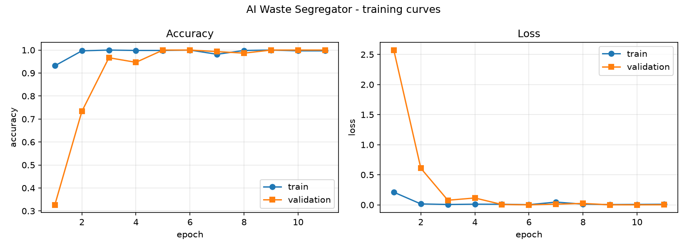
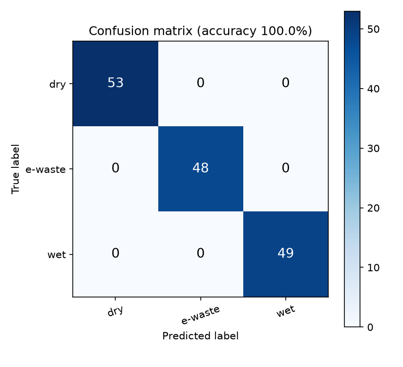
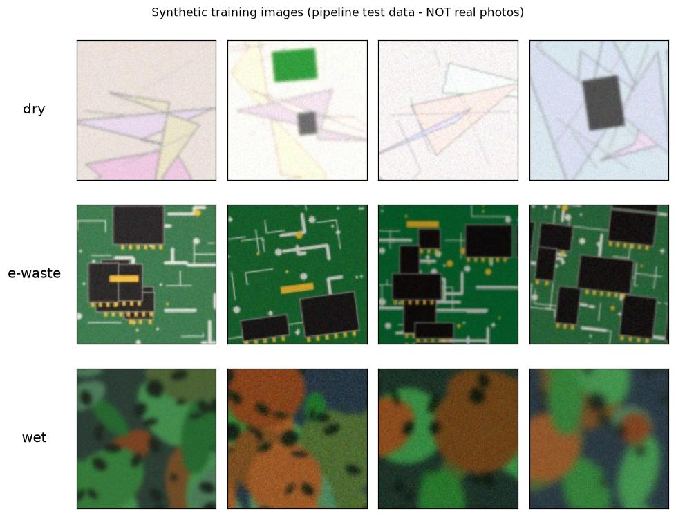

# ♻️ AI-Powered Smart Waste Segregator

**RSBVP Sub-theme: Waste Management**

A computer-vision system that watches a webcam **in real time** and tells
you which bin a piece of waste belongs in:

| Class | Examples | Correct disposal |
|---|---|---|
| 🔵 **Dry waste** | paper, cardboard, plastic, metal, glass | **Blue bin** (recyclable) |
| 🟢 **Wet waste** | vegetable peels, food scraps, leaves | **Green bin** (compostable) |
| 🔴 **E-waste** | old phones, chargers, batteries, circuit boards | **Red bin / authorised collector** |

Built with **Python, OpenCV and TensorFlow** — with a no-code
**Google Teachable Machine** alternative for anyone who prefers that path.


---

## How it works

```
        webcam frame
             │
   ┌─────────▼─────────┐   crop the centre square,
   │  OpenCV pre-process│  resize to 96x96, float 0-255
   └─────────┬─────────┘
   ┌─────────▼─────────┐   3 conv blocks (32→64→128 filters,
   │      CNN model     │   BatchNorm + pooling) + dense head
   └─────────┬─────────┘
   ┌─────────▼─────────┐   softmax probabilities per class,
   │  smoothing (10 fr) │  averaged over the last 10 frames
   └─────────┬─────────┘
   ┌─────────▼─────────┐
   │  verdict on screen │  class + confidence + which bin to use
   └──────────────────┘   (or: open the right servo lid on a smart bin)
```

The model, pre-processing and data augmentation are all plain Keras code
in [`src/train.py`](src/train.py) — no hidden magic, everything is meant to
be read and modified for your own experiments.

---

## Quick start (2 minutes)

```bash
# 1. install Python 3.9+ then:
pip install -r requirements.txt

# 2. run the live demo with the bundled demo model
python src/predict_webcam.py
```

A camera window opens. Hold any object inside the square and the app shows
the predicted class, a confidence % and the bin it belongs in.

> ⚠️ **About the bundled model:** `models/waste_segregator_demo.keras` was
> trained on **synthetic** images, so it reacts to colour/texture only. It
> proves the pipeline works. For the real exhibition, collect real photos
> and train your own model — that takes about 15 minutes (below).

No camera? Test with a photo instead:

```bash
python src/predict_webcam.py --image path/to/photo.jpg
```

---

## Build the REAL model (the actual homework)

### Step 1 — Collect images (`scripts/capture_dataset.py`)

```bash
python scripts/capture_dataset.py --class dry --auto 0.5     # hold items, auto-click every 0.5 s
python scripts/capture_dataset.py --class e-waste --auto 0.5
python scripts/capture_dataset.py --class wet --auto 0.5
```

Aim for **100–200 images per class**. Show **many different objects**, from
different angles, distances, backgrounds and lighting — that matters more
than the number of images. Keys: `SPACE` save · `a` auto-save · `n` next
class · `q` quit.

*(For an instant pipeline test without a camera you can generate synthetic
images instead: `python scripts/make_synthetic_dataset.py` — but these are
not suitable for the real model.)*

### Step 2 — Train (`src/train.py`)

```bash
python src/train.py            # add --tflite to also export a Raspberry Pi model
```

Watches validation accuracy with early stopping, then saves:

- `models/waste_segregator.keras` — your model
- `models/waste_segregator_metadata.json` — class order + input size
- `docs/plots/training_curves.png` — accuracy/loss curves for your report

### Step 3 — Evaluate (`src/evaluate.py`)

```bash
python src/evaluate.py                       # on the held-out validation split
python src/evaluate.py --test-dir my_test/   # on your own unseen test photos (best!)
```

Prints a per-class precision/recall report and saves
`docs/plots/confusion_matrix.png`.

### Step 4 — Real-time demo (`src/predict_webcam.py`)

```bash
python src/predict_webcam.py
```

Your freshly trained model is picked up automatically. Keys: `q` quit ·
`s` save snapshot · `m` mirror.

---

## Prefer no code? Teachable Machine path

Train in the browser at https://teachablemachine.withgoogle.com, export
**TensorFlow → Keras**, and run it with this project's app:

```bash
python src/predict_webcam.py --model models/model.h5 --labels models/labels.txt
```

Full walkthrough: [`docs/TEACHABLE_MACHINE.md`](docs/TEACHABLE_MACHINE.md).

---

## Hardware extension: the smart bin 🗑️

For the exhibition prototype, `src/servo_bin.py` turns a Raspberry Pi +
three servos into a bin that **opens the correct lid** for the predicted
class. It needs `TRIGGER_FRAMES` confident frames before opening, so it
doesn't flap.

```bash
python src/servo_bin.py --simulate     # try the logic on any PC
python src/servo_bin.py                # on the Raspberry Pi (gpiozero)
```

| Lid | Servo signal pin (BCM) |
|---|---|
| dry (blue) | GPIO 12 |
| e-waste (red) | GPIO 13 |
| wet (green) | GPIO 18 |

Power the servos from their own 5 V supply and connect all grounds
together. Full wiring notes are in the script's docstring.

---

## Project structure

```
.
├── config.py                     # single place for all settings
├── requirements.txt
├── scripts/
│   ├── capture_dataset.py        # webcam → dataset/<class>/*.jpg
│   └── make_synthetic_dataset.py # offline synthetic test data
├── src/
│   ├── train.py                  # CNN training (TensorFlow/Keras)
│   ├── evaluate.py               # report + confusion matrix
│   ├── predict_webcam.py         # real-time webcam demo
│   └── servo_bin.py              # optional Raspberry Pi smart-bin lids
├── models/
│   ├── waste_segregator_demo.keras       # synthetic-data demo model
│   └── waste_segregator_demo_metadata.json
├── docs/
│   ├── TEACHABLE_MACHINE.md      # the no-code training path
│   ├── PROJECT_REPORT.md         # RSBVP report template
│   └── plots/                    # training curves, confusion matrix, …
└── dataset/                      # created by you (git-ignored)
```

## Results (bundled demo model, synthetic data)

| | |
|---|---|
| Training curves |  |
| Confusion matrix |  |
| Synthetic samples |  |

*(These numbers describe the synthetic-data demo only — publish your own
numbers from real data in your report!)*

## Troubleshooting

| Problem | Fix |
|---|---|
| `could not open the webcam` | Close other apps using the camera; try `--source 1`; on Windows the app already retries with DirectShow. |
| TensorFlow install fails | Use `pip install tensorflow-cpu`; needs Python 3.9–3.12 (64-bit). |
| Demo is slow / low FPS | Close heavy apps; shrink the camera resolution in the script; or train with `--img-size 64`. |
| Predictions flicker | Normal for single frames — the app already averages 10 frames; more light helps. |
| Accuracy is poor | More *varied* images per class (angles/backgrounds), then retrain. Check the confusion matrix to see which classes get mixed up. |
| `model.h5` from Teachable Machine predicts nonsense | Add `--normalize`. |

## License

MIT — see [LICENSE](LICENSE).
