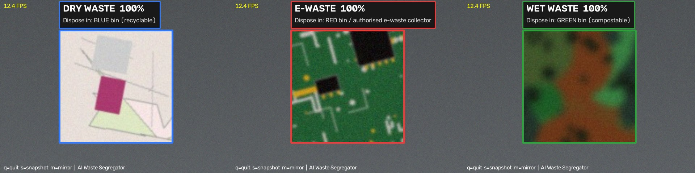

# Project Report — AI-Powered Smart Waste Segregator

> Template for the RSBVP (Sub-theme: Waste Management) write-up.
> Fill in the **[brackets]** and paste your own results from
> `docs/plots/` and the printed output of the scripts.

---

## 1. Title

**AI-Powered Smart Waste Segregator** — a computer-vision system that
recognises **dry**, **wet** and **e-waste** from a live camera feed and
tells the user (or a smart bin) where the item must go.

## 2. Abstract

*[~150 words. Example:]*
In India, mixed waste makes recycling expensive and composting impossible.
We built an AI system that classifies waste into dry, wet and e-waste
categories in real time using a webcam. A convolutional neural network was
trained on [N] images collected with [webcam / Teachable Machine]. The
model reached **[xx.x]% accuracy** on unseen validation images. The
software shows the correct disposal bin (blue / green / red) live on
screen, and an optional Raspberry Pi version opens the matching bin lid
with a servo motor. The system can be installed on school dustbins to
teach correct segregation and to reduce contaminated waste.

## 3. Introduction & Problem Statement

- India generates over 1.7 lakh tonnes of municipal solid waste every day
  *(update with a recent figure from CPCB/Swachh Bharat reports and cite
  the source)*, and a large part is not segregated at source.
- The Solid Waste Management Rules, 2016 require segregation into **wet
  (green bin)** and **dry (blue bin)**; e-waste must go to authorised
  collectors (E-Waste Rules, 2022).
- People are often *confused* about which bin to use — this project removes
  the confusion with an instant AI answer.

## 4. Objectives

1. To collect/curate a dataset of waste images in three classes: dry, wet, e-waste.
2. To train a computer-vision model (CNN) using Python, OpenCV and TensorFlow.
3. To classify waste in **real time** from a webcam feed.
4. To demonstrate a working smart-bin prototype that opens the correct lid.

## 5. Methodology

1. **Data collection** — `scripts/capture_dataset.py` grabs images from the
   webcam; [N] images per class; varied angles, distances, lighting.
2. **Pre-processing** — centre-crop, resize to 96x96, scale pixels to 0–1.
3. **Augmentation** — random flips, rotations, zoom and contrast during
   training so the model generalises.
4. **Model** — a compact CNN:
   *Table: fill from `model.summary()` output*
   | Layer (repeated 3x) | Output |
   |---|---|
   | Conv2D 3x3 (32 → 64 → 128) + BatchNorm + ReLU | 96x96x32 → 48x48x64 → 24x24x128 |
   | MaxPooling2D | halves each block |
   | GlobalAveragePooling2D → Dense(128) → Dropout(0.4) | 128 |
   | Dense(3, softmax) | dry / e-waste / wet probabilities |
5. **Training** — Adam optimiser, sparse categorical cross-entropy,
   early stopping on validation accuracy.
   *(or: "trained on Google Teachable Machine", if you used that path)*
6. **Real-time inference** — `src/predict_webcam.py` predicts every frame,
   averages the last 10 predictions for stability and shows the bin colour.

## 6. Observations & Results

- Training curves: `docs/plots/training_curves.png`
- Confusion matrix: `docs/plots/confusion_matrix.png`
- Best validation accuracy: **[xx.x %]**
- Typical frame rate on [laptop model]: **[xx] FPS**

| Class | Precision | Recall | F1-score |
|---|---|---|---|
| dry | [ ] | [ ] | [ ] |
| e-waste | [ ] | [ ] | [ ] |
| wet | [ ] | [ ] | [ ] |

## 7. Applications

- Smart dustbins in schools, offices, food courts and railway stations.
- Teaching aid for correct segregation habits.
- Sorting-assist tool for waste workers and scrap dealers.
- Extensible to more classes (medical waste, sanitary waste, recyclable types).

## 8. Future Scope

- Train on a larger, crowdsourced dataset for higher accuracy.
- Run on a Raspberry Pi with the TFLite model (`--tflite` flag) fully offline.
- Add a weight sensor and a "bin full" alert.
- Gamified mobile app that rewards correct disposal.

## 9. Conclusion

*[2–3 sentences: what you built, what result you got, what it proves.]*

## 10. References

1. TensorFlow documentation — https://www.tensorflow.org
2. OpenCV documentation — https://docs.opencv.org
3. Teachable Machine — https://teachablemachine.withgoogle.com
4. CPCB / Swachh Bharat Mission urban waste statistics — *[add exact page]*
5. Solid Waste Management Rules, 2016; E-Waste (Management) Rules, 2022

## 11. Acknowledgements

*Guide teacher, school, family, open-source community...*

---

**Team:** [Name(s)] &nbsp;|&nbsp; **Class:** [ ] &nbsp;|&nbsp; **School:** [ ]
